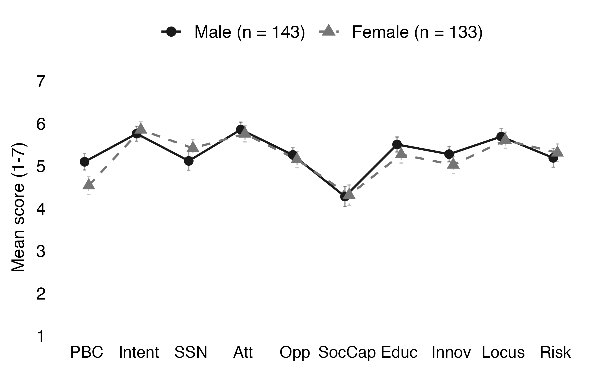

# Multivariate Differences in Entrepreneurial Profiles

MANOVA and descriptive linear discriminant analysis (LDA) of how university students' entrepreneurship-related profiles differ by gender and by self-reported entrepreneurial inclination, using an open dataset. Originally developed as a graduate course project.

## Questions

1. Do male and female students differ in their overall profiles across ten entrepreneurship-related constructs?
2. Do students who report entrepreneurial inclination differ in their profiles from students who do not?

## Data

The analysis uses Saleem and Anwar's (2023) open dataset of 276 business and management students at three universities in Oman. It includes ten validated construct scores on a 1–7 scale: perceived behavioral control, entrepreneurial intention, subjective social norm, entrepreneurial attitude, opportunity recognition, social capital, entrepreneurship education, innovativeness, locus of control, and risk-taking propensity. See [`data/README.md`](data/README.md) for the source, citation, and license.

## Methods

- Two one-way MANOVAs (by gender and by inclination) on the ten composite scores, with Pillai's trace as the primary test statistic
- Assumption checks: sample size relative to the number of outcomes, multicollinearity, multivariate outliers (Mahalanobis distance), multivariate normality (Mardia's test), and homogeneity of covariance matrices (Box's M)
- LDA as a descriptive follow-up, using standardized coefficients and structure correlations
- Sensitivity analyses: rerunning each model without multivariate outliers, and rerunning the inclination model without the intention construct, which overlaps conceptually with the grouping variable

## Main findings

- **Gender:** a significant and stable multivariate difference (Pillai's V = .132, F(10, 265) = 4.05, p < .001), unchanged after removing outliers (V = .140). Perceived behavioral control, higher among male students, contributed most to the separation; subjective social norm characterized the female side.
- **Inclination:** a small difference in the full model (V = .067, p = .045) that was no longer significant without outliers (p = .081) or without the intention construct (p = .114), so it should be interpreted cautiously.
- The outcomes departed from multivariate normality, and Box's M was significant for the inclination model, which is why Pillai's trace was emphasized.



*Mean scores (1–7) on the ten constructs for male and female students.*

## Reproducing the results

Requires R with tidyverse, psych, car, biotools, MASS, and MVN. The analysis script installs any that are missing. From the repository root:

```sh
Rscript R/01_manova_lda.R      # assumption checks, MANOVAs, LDA, and sensitivity analyses (printed to the console)
Rscript R/02_profile_plots.R   # profile plots and outcome correlation plot, saved to output/
```

## Repository structure

```
data/entrepreneurship.csv    Saleem and Anwar (2023) dataset (CC BY 4.0)
data/README.md               Data source, citation, and license
R/01_manova_lda.R            Assumption checks, MANOVAs, LDA, and sensitivity analyses
R/02_profile_plots.R         Profile plots and outcome correlation plot
output/                      Figures
```

## License

The code is released under the MIT License (see `LICENSE`). The data are by Saleem and Anwar (2023) and are shared under CC BY 4.0; see [`data/README.md`](data/README.md).
